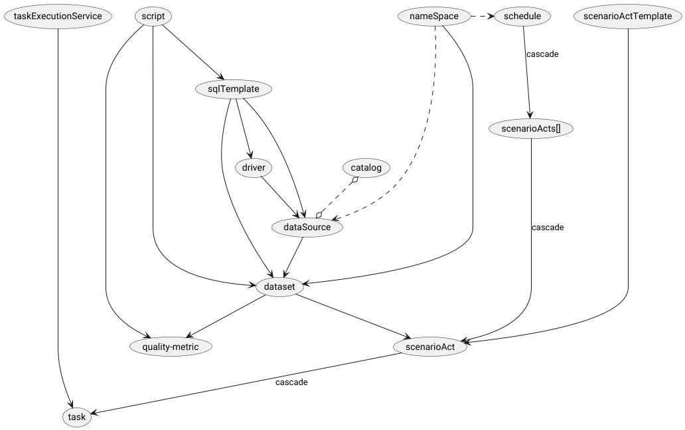
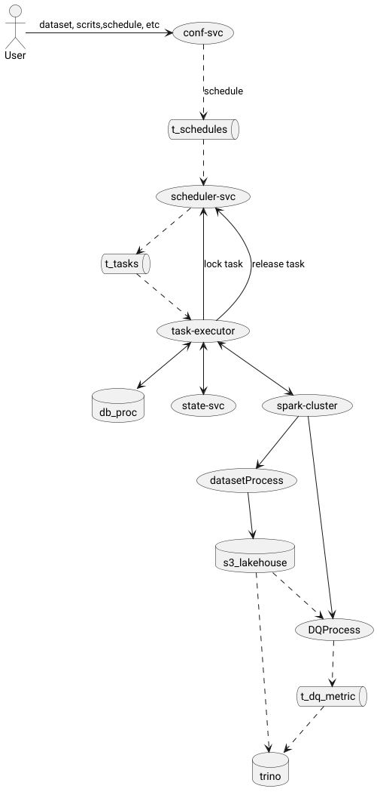

# Сборка

[Описание сборки образов](../../docker/readme.md)

# Запуск сервисов

Перейти в терминале в корне проекта в каталог demo/compose. Там расположен файл docker-compose.yml
Выполнить команду

```shell
docker compose up -d
```

## Airflow 2.7.3

В демо добавлен Apache Airflow **2.7.3** с установленной интеграцией
`yarina-airflow-integration/2.x`.

| Параметр | Значение |
|:---------|:---------|
| UI | http://localhost:8088 |
| Логин / пароль | `admin` / `admin` |
| Плагины | `/opt/airflow/plugins` (образ `yarina-airflow:2.7.3`) |
| DAG-шаблоны | `yarina-airflow-integration/examples/2.x` (монтируются в `/opt/airflow/dags`) |
| Metadata DB | PostgreSQL `db-dev`, база `airflow` |

База `airflow` создаётся скриптом `conf_infra/airflow/init_airflow_db.sql` при
первой инициализации тома `db-dev`. Если том уже существует и базы нет,
создайте её вручную:

```shell
docker exec db-dev psql -U postgresUser -d postgresDB -c 'CREATE DATABASE airflow;'
```

Подключения уже заданы в `docker-compose.yaml` через `AIRFLOW_CONN_*`:

| Connection id | Сервис |
|:--------------|:-------|
| `yarina_state_default` | `http://yarina-state-svc:8084` |
| `yarina_config_default` | `http://yarina-config-svc:8082` |
| `yarina_spark_proxy_default` | `http://yarina-task-proxy4spark:8086` |

`extra.auth_url` указывает на **токен-эндпоинт** Keycloak
(`http://keycloak.yarina:8085/realms/yarina/protocol/openid-connect/token`),
login/password - на `yarina-internal-client`.

Образ собирается из каталога `yarina-airflow-integration` (см.
`conf_infra/airflow/Dockerfile`). После изменения кода интеграции пересоберите
только Airflow:

```shell
docker compose build airflow
docker compose up -d airflow
```

После старта доступны DAG-шаблоны `yarina_split_lock_lifecycle` и
`yarina_spark_submit_example`. Перед запуском Spark-шаблона замените
`app_resource` на существующий артефакт.

### Настройка хост машины
Требуется строка в файле /etc/hosts хоста 
```
127.0.0.1 keycloak.yarina

```
### Совпадения имен
Возможны ошибки о том, что контейнеры которые должны быть запущены уже существуют. Это либо контейнеры от предыдущих попыток запуска, либо одноименные контейнеры. Нужно убедиться, что они
действительно не нужны и удалить их.

> Error response from daemon: Conflict. The container name "/broker" is already in use by container "
> 47230bbef2717dc571455f72bec3b4e3be2636d340e8dffac4c2d7e1cd4c1f5a". You have to remove (or rename) that container to be
> able to reuse that name.

```shell
docker container rm broker 
docker container rm conf-svc 
docker container rm db-dev
docker container rm demo-trino-1
docker container rm compose-trino-1
docker container rm hive-metastore
docker container rm minio-dev 
docker container rm scheduler-svc
docker container rm spark-history
docker container rm spark-master
docker container rm spark-worker-1
docker container rm state-svc
docker container rm task-executor-svc-database
docker container rm task-executor-svc-spark
docker container rm task-executor-svc-state
docker container rm yarina-task-proxy4spark
docker container rm airflow

```
#### Сеть
В конфигурации определена сеть. Для обычной демонстрации это не нужно, но для использования сервисов клиентам хост-машины не всегда достаточно пробросить порт контейнера на localhost. 
На пример брокер или spark-master/worker ui.   
```yaml
networks:
  yarina_net:
    driver: bridge
    ipam:
      config:
        - subnet: 172.20.193.0/24
```
Многие файлы конфигурации могут использовать IP адрес для указания сервера.

# Загрузка демонстрационной конфигурации
### Rest-api вариант
> Приоритетно загружается VCS-git вариант, который прогрузит всю конфигурацию сам и вам ничего делать не нужно. Он заблокирует работу rest-api 

### VCS-git вариант
В этой сборке он работает по умолчанию и соответственно блокирует rest-api вариант 
Все настройки нужно производить в папке conf_git. Затем пересоздать сервис. В процессе создания сервис сам положит в репозиторий папку conf_git
Подробнее тут git-server-config-repo.md

### Зависимость ключей в конфигурациях




## Ссылки
[minio](http://localhost:9001/login)  

[spark-master](http://192.1.193.40:8400/)

[spark-worker](http://192.1.193.50:8401/)

[spark-history](http://localhost:18080/)

[Airflow](http://localhost:8088/)

[UI](http://localhost:8084/)

## Поток управления



# Удаление 

Выполнить удаление контейнеров 

```shell
docker compose down -v
```

Очистить данные хранилища minio. Потребуются root привилегии тк сервис работает в контейнере под root  
```shell
bash su_cleanup.bash
```