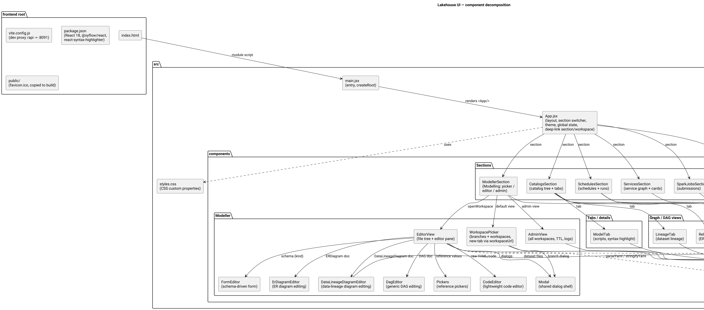
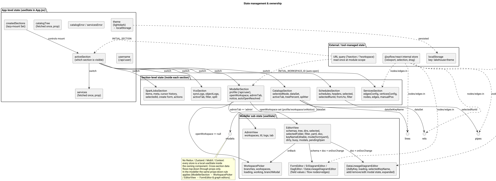
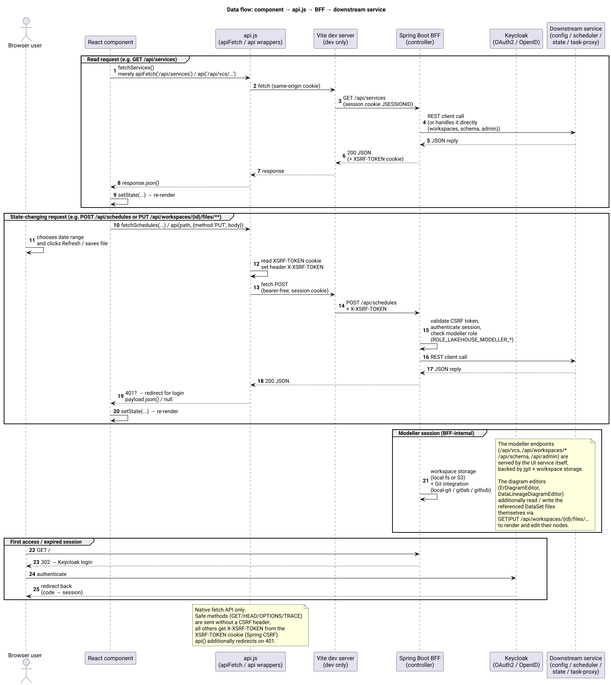
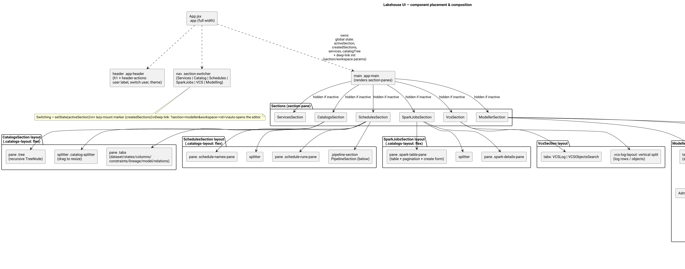
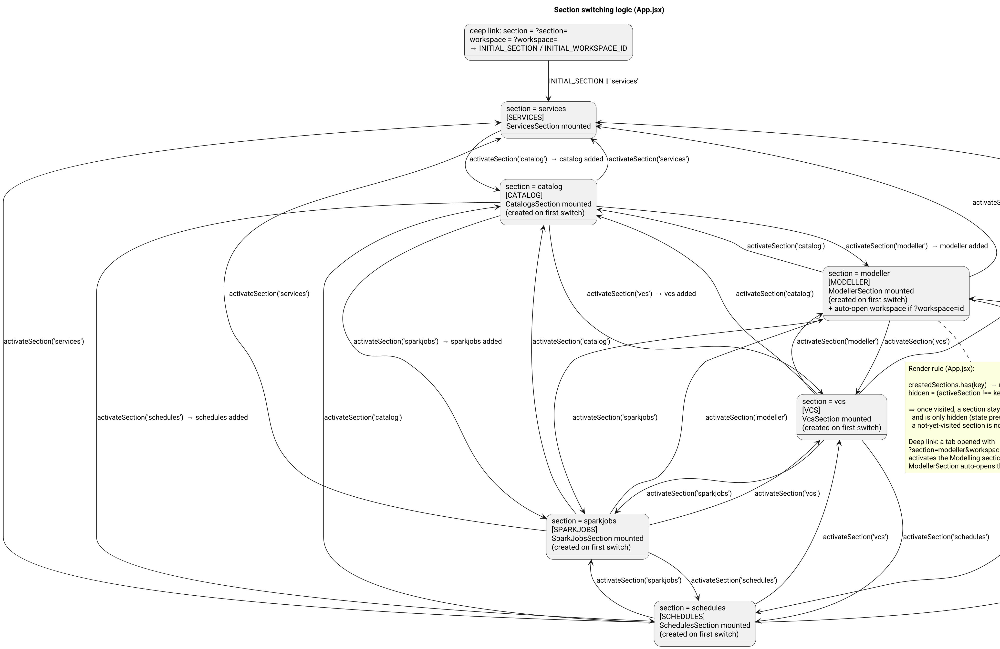

# Jarina UI — обзор архитектуры фронтенда

> Аудит состояния на момент коммита React-фронтенда, расположенного в
> `jarina-ui-svc/src/main/resources/frontend`.
>
> Область: `index.html`, `public/`, `vite.config.js`, `package.json`, `test/`
> (настройка Vitest), `src/` (исходники JSX, стили, API-клиент, работа с YAML,
> хуки, тесты компонентов). Цель: высокоуровневое понимание для системного
> архитектора и формулирование изолированных задач по доработке.
>
> Диаграммы (исходники PlantUML в `diagrams/`):

| Диаграмма | Файл |
|---|---|
| Декомпозиция компонентов | `diagrams/overview.png` |
| Размещение и композиция компонентов | `diagrams/placement.png` |
| Логика переключения разделов | `diagrams/section-switching.png` |
| Поток данных / интеграция с API | `diagrams/data-flow.png` |
| Владение состоянием | `diagrams/state-management.png` |

---

## 1. Архитектурный подход и паттерны

Фронтенд — это **одностраничное приложение (SPA)** на **React 18**, собираемое
**Vite**. Модель декомпозиции — **плоская, компонентная, ориентированная на
функции структура**, близкая по духу к облегчённому Feature-Sliced /
слоистому паттерну без формального принуждения:

- **Корневой / прикладной слой** — `main.jsx` (точка входа, `createRoot`) и
  `App.jsx` (оболочка: заголовок, переключатель разделов, тема, общее
  состояние, инициализация по deep-ссылке).
- **Функциональные разделы** — один верхнеуровневый компонент на UI-домен
  (`ServicesSection`, `CatalogsSection`, `SchedulesSection`,
  `SparkJobsSection`, `VcsSection`, `ModellerSection`). Каждый раздел
  самодостаточен: он владеет своей загрузкой данных, своими под-представлениями
  и локальным состоянием. `ModellerSection` (вкладка **Modelling**) управляет
  потоком picker→editor→admin, реализованным выделенной группой компонентов, но
  по-прежнему переиспользует общую сессию, обработку CSRF и идентичности.
- **Общая инфраструктура** — `api.js` (единственная точка сетевого доступа),
  `styles.css` (глобальные стили + дизайн-токены), `yaml.js` (независимое от
  схемы чтение/запись YAML для конфигурационных документов),
  `hooks/useResizableSplit.js` (общее поведение перетаскивания для изменения
  размера).
- **Под-представления / компоненты редакторов** — меньшие компоненты внутри
  функционального раздела (`LineageTab`, `RelationsTab`, `ModelTab`,
  `PipelineSection`, рекурсивный `TreeNode`); группа модделирования добавляет
  `WorkspacePicker`, `EditorView`, `AdminView`, `FormEditor`, `ErDiagramEditor`,
  `DataLineageDiagramEditor`, `DagEditor`, `Pickers`, `CodeEditor`, `Modal`.

Ключевые правила организации кода, задавшие реализацию:

1. **Один компонент = один файл** в `src/components/`, названный по UI-понятию;
   компоненты вкладок/под-представлений лежат рядом с разделом, которому
   принадлежат.
2. **Единый источник истины для ввода-вывода** — весь HTTP-доступ идёт через
   `api.js`; компоненты никогда не вызывают `fetch` напрямую.
3. **Разделение ответственности** — `api.js` (транспорт/аутентификация/CSRF),
   компоненты (рендер + состояние взаимодействия), `styles.css`
   (представление), `yaml.js` (сериализация/десериализация YAML), `hooks/`
   (переиспользуемое краткоживущее поведение UI). Бизнес-логика намеренно
   *не* выносится в хранилища — она остаётся внутри разделов и сервисов
   модделирования за BFF.
4. **Ленивое монтирование, сохраняемые разделы (keep-alive)** — разделы
   монтируются при первом использовании и затем остаются живыми (см. §6):
   переключение сохраняет состояние каждого раздела.
5. **Данные вниз, состояние вверх** — межраздельные данные передаются сверху
   вниз как props; глобального хранилища нет.
6. **Вход по URL (deep-ссылки)** — `App.jsx` один раз читает query-параметры
   `section` и `workspace` (на уровне модуля) и использует их как начальный
   раздел и, для раздела Modelling, как рабочее пространство для автооткрытия.
   Это обеспечивает сценарий «открыть рабочее пространство в новой вкладке».

---



---

## 2. Структура проекта и репозитория

```
src/main/resources/frontend
├── index.html              # HTML-оболочка, <div id="root">, загружает /src/main.jsx
├── package.json            # deps: react, react-dom, @xyflow/react,
│                           #       react-syntax-highlighter; dev: vite,
│                           #       vitest, jsdom, @testing-library/*;
│                           #       scripts: dev / build / preview / test
├── package-lock.json
├── vite.config.js          # dev-сервер :5173, прокси /api -> :8091,
│                           # сборка outDir -> ../static (раздаётся Spring Boot),
│                           # блок test (jsdom, test/setup.js); см. §7
├── public/                 # статические ресурсы, копируемые как есть в сборку
│                           #   (favicon.ico)
├── test
│   └── setup.js            # настройка Vitest: jsdom-полифиллы, нужные
│                           #   React Flow (ResizeObserver, DOMMatrixReadOnly,
│                           #   pointer capture, offsetWidth/Height,
│                           #   getBoundingClientRect)
└── src
    ├── main.jsx            # точка входа: createRoot(...).render(<App/>)
    ├── App.jsx             # оболочка: заголовок, переключатель разделов (nav),
    │                       #       main-область; глобальное состояние
    │                       #       (активный/созданные разделы, тема, сервисы,
    │                       #       каталог, имя пользователя, ошибки)
    │                       #       + инициализация deep-ссылки (section/workspace)
    ├── api.js              # обёртки fetch (CSRF, 401 → логин) + все REST-вызовы,
    │                       #       вкл. хелпер deep-ссылки workspaceUrl()
    ├── yaml.js             # самописный читатель/писатель YAML (подмножество),
    │                       #       используемый редакторами модделирования
    ├── styles.css          # глобальный CSS: токены (CSS custom properties),
    │                       #       все стили компонентов (~3.2k строк)
    ├── hooks
    │   └── useResizableSplit.js   # общее поведение перетаскивания разделителя
    └── components
        ├── ServicesSection.jsx    # граф сервисов (React Flow) + карточки статусов
        ├── CatalogsSection.jsx    # дерево каталога (рекурсивный TreeNode) + панель
        │                          #   вкладок (dataset / states / columns /
        │                          #   constraints / lineage / model / relations)
        ├── SchedulesSection.jsx   # имена расписаний + запуски + PipelineSection
        ├── SparkJobsSection.jsx   # список Spark-подписок + детали + действия
        ├── VcsSection.jsx         # журнал синхронизации VCS + журнал объектов
        │                          #   (использует hooks/useResizableSplit)
        ├── ModellerSection.jsx    # Modelling: picker / редактор / админ
        ├── WorkspacePicker.jsx    # дерево веток по доменам, «мои пространства»,
        │                          #   модалка создания ветки; «Open» переходит
        │                          #   через workspaceUrl()
        ├── EditorView.jsx         # дерево файлов пространства + панель редактора
        │                          #   (самый крупный компонент, ~1k строк)
        ├── AdminView.jsx          # только для админов: все пространства, TTL, логи
        ├── FormEditor.jsx         # рендерер форм по схеме для конф. документов
        ├── ErDiagramEditor.jsx    # визуальное редактирование ER-диаграмм (React Flow)
        ├── DataLineageDiagramEditor.jsx  # редактирование диаграмм линковки данных
        │                          #   (React Flow; Add/Edit/Remove на холсте,
        │                          #   модалки выбора/подтверждения, полный экран)
        ├── DagEditor.jsx          # универсальное визуальное редактирование DAG
        ├── Pickers.jsx            # справочные пикеры (датасет / скрипт / DS…)
        ├── CodeEditor.jsx         # лёгкий редактор кода с подсветкой синтаксиса
        ├── Modal.jsx              # общая оболочка модальных окон
        ├── PipelineSection.jsx    # DAG экземпляра расписания (акты + вложенные задачи)
        ├── LineageTab.jsx         # граф линковки датасета (React Flow)
        ├── ModelTab.jsx           # скрипты моделей с подсветкой синтаксиса
        ├── RelationsTab.jsx       # представление ER-диаграммы (React Flow)
        └── __tests__/             # unit-тесты Vitest для модделирования
                                   #   (DataLineageDiagramEditor 24, EditorView 5,
                                   #   FormEditor 7, WorkspacePicker 5) — см. §7
```

Назначение каждой папки/файла:

- **`components/`** — функциональные разделы и их под-представления;
  единственная директория для UI-компонентов. Группа модделирования образует
  собственное пространство имён
  (`ModellerSection` + `WorkspacePicker/EditorView/AdminView/FormEditor/
  ErDiagramEditor/DataLineageDiagramEditor/DagEditor/Pickers/CodeEditor/Modal`)
  плюс тестовую папку `__tests__/` для неё. Папок `context/`, `services/`,
  `utils/`, `types/` не существует; эквивалентная логика живёт прямо в
  компонентах.
- **`hooks/`** — вынесенное переиспользуемое поведение UI; сейчас это один хук
  `useResizableSplit` (перетаскивание для изменения размера панелей,
  `horizontal`/`vertical`).
- **`yaml.js`** — не зависящий от внешних библиотек парсер/сериализатор
  подмножества YAML, созданный для конфигурационных документов jarina (мапы,
  списки, скаляры, строки в кавычках, вложенность по отступам, блочные скаляры
  `|`/`|-`/`|+`). Комментарии отбрасываются; бэкенд повторно валидирует каждый
  документ своим YAML-парсером.
- **`api.js`** — слой интеграции с бэкендом (см. §4).
- **`styles.css`** — единственная глобальная таблица стилей; темизация через
  CSS custom properties, переключаемые атрибутом `data-theme` (`light`/`dark`).
- **`App.jsx`** — оркестратор: сообщает браузеру, *какой компонент где
  рендерится* (см. §6).

---

## 3. Управление состоянием

**Технологии: только нативный `useState`.** Нигде в кодовой базе нет Redux
Toolkit, Zustand, MobX или React Context. Всё состояние локально и
принадлежит использующему его компоненту.

Области и обязанности:

- **Уровень модуля / приложения** (`App.jsx`):
  - `services`, `catalogTree`, `username` — данные, загружаемые один раз при
    старте и передаваемые вниз как props;
  - `catalogError`, `servicesError` — производные ошибки загрузки;
  - `theme` — `light`/`dark`, читается из `localStorage` по ключу
    `jarina-theme` и записывается обратно при каждом изменении (`useEffect`
    также выставляет `document.documentElement.dataset.theme`);
  - `activeSection`, `createdSections` — движок размещения/переключения (см.
    §6): какой раздел видим и какие разделы были смонтированы;
  - `INITIAL_SECTION` / `INITIAL_WORKSPACE_ID` — читаются один раз из
    `location.search` (`?section=…&workspace=…`) и используются для
    предварительной активации раздела Modelling и автооткрытия пространства.
- **Уровень раздела** — каждый `*Section` хранит свои данные, фильтры и
  UI-флаги:
  - `CatalogsSection` (`selectedNode`, `dataSet`, `activeTab`, …);
  - `SchedulesSection`, `SparkJobsSection`, `VcsSection` (перечислены в
    `state-management.puml`);
  - `ModellerSection` — `profile` (из `/api/user`), `openWorkspace`,
    `adminTab`, `notice` (автоистекающий баннер), `autoOpenResolved`;
  - `WorkspacePicker` — `domains`, `workspaces`, `loading`, `working`,
    `branchModal`;
  - `EditorView` — `schemas`, `tree`, `dirs`, `selected`, `selectedFolder`,
    `filter`, `yaml`, `doc`, `keyNameEditable`, `mode` (`form`|`yaml`),
    `dirty`, `busy`, флаги модалок, `pendingOpen` (защита от несохранённых
    изменений); `readOnly` выводится из `profile.effectiveRole` +
    `workspace.own`.
- **Уровень под-представлений / вкладок** — `LineageTab`, `RelationsTab`,
  `ModelTab`, `PipelineSection`, `FormEditor`, `ErDiagramEditor`,
  `DataLineageDiagramEditor`, `DagEditor` (схемы по видам из `SchemaService`
  разворачиваются в модель формы `FormEditor`; графовые редакторы выводят свои
  списки узлов/рёбер из `doc`).
- **Редакторы диаграмм** — `ErDiagramEditor` и `DataLineageDiagramEditor`
  дополнительно владеют загруженными документами указанных DataSet и
  состоянием своих диалогов: `dsByKey`/`dsByPath`, `loading`,
  `selectedKeyName`/`selectedNodeId`, `addOpen`, цель подтверждения удаления,
  состояние модалки редактирования (`editTarget`, `editYaml`, `editDoc`,
  `editMode` `form`|`yaml`, `editKeyNameEditable`, `editBusy`) и флаг
  полноэкранного режима `expanded` (переключатель `<-->`/`>-<`).
- **Управляется инструментом** — `@xyflow/react` (React Flow) держит
  собственное внутреннее хранилище (viewport, выделение узлов, состояние
  перетаскивания); сами узлы/рёбра принадлежат разделу и синхронизируются в
  поток через props.

Межраздельная коммуникация происходит исключительно **сверху вниз через props**
и **снизу вверх через единственную общую оболочку** (`App.jsx`). Пример:
`ModellerSection` передаёт `profile`, `workspace` и `onNotice` вниз в
`WorkspacePicker`/`EditorView`; `EditorView` передаёт `doc` и `onDocChange`
(`onChange` для редактора линковки) в
`FormEditor`/`ErDiagramEditor`/`DataLineageDiagramEditor`.



---

## 4. Поток данных и интеграция с API

**Сетевая библиотека: нативный Fetch API** (ни Axios, ни RTK Query, ни React
Query). Все вызовы централизованы в `src/api.js`, который экспортирует две
обёртки:

- `apiFetch(url, options)` — базовая обёртка; для каждого небезопасного метода
  (`POST/PUT/PATCH/DELETE`) читает CSRF-токен из cookie `XSRF-TOKEN` и
  добавляет заголовок `X-XSRF-TOKEN`.
- `api(path, { method, body })` — JSON-обёртка, используемая модделированием
  (`WorkspacePicker`, `EditorView`, `AdminView`). Устанавливает
  `Content-Type: application/json`, добавляет CSRF-заголовок для
  изменяющих состояние методов, возвращает `null` для `204`, нормализует
  серверные `error`-payload'ы и — при любом `401` — перенаправляет браузер на
  точку входа логина Keycloak.

**Аутентификация / обработка токенов.** UI не работает с JWT-токенами напрямую.
Аутентификация выполняется на стороне сервера Spring Boot **BFF**
(`jarina-ui-svc`):

- Браузер аутентифицируется в **Keycloak** по OAuth2 authorization-code flow;
  при успехе Spring Security выдаёт сессионную cookie `JSESSIONID`
  (`HttpOnly`).
- Приложение работает на том же origin, что и BFF, поэтому запросы
  same-origin и учётные данные отправляются неявно.
- **CSRF**: Spring отдаёт токен в cookie `XSRF-TOKEN`. Обе обёртки добавляют
  заголовок `X-XSRF-TOKEN` для небезопасных методов.
- **RBAC**: эндпоинты модделирования дополнительно защищены ролями realm
  Keycloak `VIEWER / _EDITOR / _ADMIN` (с иерархией `ADMIN > EDITOR > VIEWER`).
  Фронтенд также получает `effectiveRole` из `GET /api/user` и скрывает вкладку
  Admin / отключает редактор для пользователей без нужного уровня.

**Deep-ссылки.** `workspaceUrl(workspaceId)` в `api.js` строит
`?section=modeller&workspace=<id>` на текущем пути. Workspace picker использует
её и как `<a target="_blank">` (существующие пространства), и — после
синхронного `window.open('', '_blank')` (безопасного для блокировщиков
всплывающих окон) — как `location` новой вкладки, как только
`POST /api/vcs/workspace` вернёт созданное пространство.

**Слой интеграции.** `api.js` также экспортирует типизированные удобные
функции, по одной на эндпоинт — например `fetchCatalogTree`, `fetchDataSet`,
`fetchLineage`, `fetchSchedules`, `fetchScheduleInstanceDAG`,
`fetchSparkSubmissions`, `fetchVcsSyncLogs`, `logout`, … Каждая выполняет
запрос к BFF, проверяет `response.ok` и возвращает разобранный JSON/text либо
кидает `Error`, который разделы рендерят в блоках `.error-box`.

**Как компоненты получают данные.** Разделы вызывают функции API внутри
`useEffect`/обработчиков событий и хранят результат через `useState`:
- **Загрузка при монтировании** — `App.jsx` грузит каталог/сервисы/пользователя;
  `EditorView` грузит `/api/schema` + дерево/каталоги пространства;
  `WorkspacePicker` грузит ветки по доменам + пространства; редакторы диаграмм
  (`ErDiagramEditor`, `DataLineageDiagramEditor`) грузят указанные документы
  DataSet при монтировании (`GET /api/workspaces/{id}/files/**`), чтобы
  построить свои узлы.
- **Загрузка по действию пользователя** — не имеющие состояния функции
  *загрузки*, привязанные к кнопкам (даты, фильтры): состояния, расписания,
  подписки, журналы VCS.
- **Загрузка с углублением** — выбор узла дерева или строки таблицы запускает
  загрузку детального payload'а (`fetchDataSet`, `fetchSparkProperties`,
  `fetchScheduleInstanceDAG`, `GET /api/workspaces/{id}/files/**`).
- **Редактирование DataSet на месте** — действие **Edit** у обоих редакторов
  диаграмм открывает модалку (`kind: DataSet · <key>`), которая повторно
  загружает указанный файл, редактирует его через `FormEditor` или текстовое
  поле «сырого» YAML и **PUT**-ит документ обратно
  (`api(path, { method: 'PUT', body: { path, yaml, keyName } })`), после чего
  узел обновляется с сервера (`reloadOne`).

**Проксирование в dev-режиме.** `vite.config.js` проксирует `/api` →
`http://localhost:8091`, так что dev-сервер общается с BFF точно так же, как в
production.



Потребляемые эндпоинты бэкенда (все относительные, проксируются BFF):

| Область | Функция api.js | Эндпоинт |
|---|---|---|
| Каталог | `fetchCatalogTree` | `GET /api/catalog/tree` |
| Каталог | `fetchDataSet` / `fetchDataSource` | `GET /api/catalog/dataset/{key}` / `.../datasource/{key}` |
| Каталог | `fetchLineage`, `fetchConstraints`, `fetchScript`, `fetchDataSetModelScript` | `GET /api/catalog/...` |
| Каталог | `fetchStates` | `POST /api/states` |
| Расписания | `fetchSchedules`, `fetchScheduleHeaders`, `fetchScheduleInstanceDAG` | `/api/schedules*` |
| Сервисы | `fetchServices`, `fetchServiceEdges`, `fetchServiceVertices` | `/api/services*` |
| Spark | `fetchSparkSubmissions`, `createSparkSubmission`, `fetchSparkStatus`, `killSparkSubmission`, `killAllSparkSubmissions`, `clearSparkCompleted`, `fetchSparkProperties` | `/api/spark-proxy/*` |
| VCS | `fetchVcsSyncLogs`, `fetchVcsObjectLogs` | `/api/vcs/logs`, `/api/vcs/objects` (оба фильтруются по `domainKeyName`) |
| Пользователь | `fetchCurrentUser`, `logout` | `GET /api/user`, `POST /logout` |
| Модделирование | вызовы `api()` в `WorkspacePicker` / `EditorView` / `AdminView` | `GET /api/vcs/workspaces`, `/api/vcs/branches`, `GET/POST/DELETE /api/vcs/workspace[/{id}]`, `POST /api/vcs/branch`, `POST /api/vcs/review/{id}`, `POST /api/vcs/workspace/{id}/restore`, `GET /api/schema[/{kind}]`, `/api/workspaces/{id}/tree|dirs|files`, `POST /api/workspaces/{id}/files(rename|move)`, `POST /api/workspaces/{id}/dirs(move)`, `/api/admin/workspaces`, `/api/admin/settings/cleanup-ttl-hours`, `/api/admin/sync-logs` |

---

## 5. Слой компонентов и стилизация

**Библиотека компонентов / дизайн-система: отсутствует. Собственные
компоненты + чистый CSS.** Нет Ant Design / Material UI / Tailwind /
styled-components / CSS Modules. Переиспользование — простая **компонентная
декомпозиция**:

- **Функциональные разделы** (`*Section`) — каждый самодостаточная единица
  уровня страницы, рендеримая внутри `main`-области оболочки.
- **Компоненты вкладок** (`.tabs` / `.tab-list` / `.tab` / `.tab-content`) —
  общий паттерн навигации внутри страницы (используется в Catalog, Model, VCS и
  переключателе `My workspaces / Admin` модделирования).
- **Общие презентационные хелперы**, определённые в модуле и переиспользуемые
  локально: `Field`, `ServicePropertiesTable`, `DescriptionList`, `StatesTab`,
  `ColumnsTab`, `ConstraintsTab`, `TreeNode` (рекурсивный рендер дерева).
- **Примитивы модделирования** — у модделирования свои переиспользуемые
  строительные блоки:
  - `Modal` — общая оболочка диалога (создание ветки, подтверждения, ревью).
  - `CodeEditor` — лёгкий редактор с номерами строк, подсветкой синтаксиса и
    моделью автодополнения по ключевым словам/Jinja (без сторонних редакторов).
  - `Pickers` — справочные пикеры (ключ датасета, ключ скрипта, namespace,
    источник данных / задача / группа сервисов / драйвер), опирающиеся на
    провайдеров, которые *сами читают документы рабочего пространства*.
  - `FormEditor` — **рендерер по схеме**: каждый вид конфигурации описан
    `KindSchema` (`GET /api/schema`), а `FormEditor` рендерит скалярные поля,
    списки/объекты, код (тип `code`) и пикеры именованных элементов по этой
    схеме, формируя/обновляя один и тот же объект `doc`.
  - `ErDiagramEditor` / `DataLineageDiagramEditor` / `DagEditor` — графовые
    редакторы на React Flow, транслирующие YAML-документ в узлы+рёбра и
    обратно. Редакторы диаграмм разделяют **панель инструментов на холсте**
    (слева сверху `Add`/`Edit`/`Remove`), **пикер ссылок** на датасет
    (`DataSetKeyPickerModal`), модалку **подтверждения** удаления, **форму
    редактирования внутри модалки** (form/YAML, переиспользует `FormEditor`) и
    **переключатель полноэкранного режима** (`<-->`/`>-<`, классы
    `.diagram-expand` + `.diagram-fullscreen` как оверлей на хосте). `DagEditor`
    — универсальный редактор узлов/рёбер, управляемый props
    `nodeField`/`edgeField`.
- **Графовые/диаграммные представления** — используют **React Flow
  (`@xyflow/react` v12)** с пользовательскими типами узлов:
  - `ServiceNode` (ServicesSection) — узел `UP`/`DOWN` с цветом статуса;
  - `PipelineActNode` / `PipelineTaskNode` (PipelineSection) — контейнеры
    активностей с вложенными плитками задач (`parentId` + `extent: 'parent'`);
  - `LineageNode` (LineageTab) — цветной центральный узел против боковых;
  - `EntityNode` (RelationsTab) — карточка ER-сущности с колонками и хэндлами
    со всех четырёх сторон;
  - `LineageNode` (`DataLineageDiagramEditor`) — узел линковки данных, стрелки
    которого выводятся из карты `sources` каждого размещённого датасета
    (отсутствующие источники рендерятся как пунктирные узлы «missing»);
  - `ErDiagramEditor`/`DataLineageDiagramEditor`/`DagEditor` переиспользуют
    узлы потока с хэндлами сущностей/рёбер для визуального редактирования
    документов ER, линковки данных и DAG.

**Подход к стилизации: глобальный `styles.css` (~3.2k строк).** Раскладка
управляется утилитарными классами CSS flex/grid и согласованным набором
классов компонентов; стили модделирования пространственно ограничены
`.modeller`, `.editor`, `.picker`, `.tabs`, `.banner`, `.lineage-*`, `.er-*`,
`.diagram-expand` и т. п. Темизация выполняется исключительно через **CSS
custom properties** (токены): `--bg`, `--panel`, `--border`, `--text`,
`--muted`, `--accent`, `--up`, `--down`, ... Две палитры объявлены под
`:root[data-theme='light']` и `:root[data-theme='dark']`; атрибут `data-theme`
переключается `App.jsx`.

---

## 6. Маршрутизация и навигация

### 6.1 Обзор

**URL-роутера нет (нет React Router).** Навигация — это чистое состояние
компонентов, дополненное deep-ссылкой на входе. Приложение — одна страница, где
единовременно видна одна интерактивная функция, переключаемая верхней панелью
навигации. Навигацию реализуют три дополняющих друг друга механизма:

1. **Переключатель разделов** — панель навигации в `App.jsx` решает, *какой
   функциональный раздел размещён в main-области* (размещение компонентов).
2. **Состояние вкладок внутри раздела** — `activeTab` в каждом разделе решает,
   *какое под-представление* (вкладка) размещено внутри тела раздела.
3. **Deep-ссылка при загрузке** — query-параметры `?section=…&workspace=…`
   задают начальный раздел и (для `section=modeller`) пространство для
   автооткрытия.

### 6.2 Логика размещения компонентов

Оболочка (`App.jsx`) задаёт фиксированную вертикальную композицию:

```
<div class="app">                        <!-- страница на всю ширину -->
  <header class="app-header">
    <h1>Jarina</h1>
    <div class="header-actions">   метка пользователя · Switch user · переключатель темы
  <nav class="section-switcher">   Services | Catalog | Schedules | SparkJobs | VCS | Modelling
  <main class="app-main">          по одному section-pane на функцию (см. ниже)
```

Внутри `main` размещены разделы:

| Ключ размещения | Кнопка | Рендеримый компонент |
|---|---|---|
| `services` | Services | `ServicesSection` (граф + карточки статусов) |
| `catalog` | Catalog | `CatalogsSection` (дерево + панель вкладок) |
| `schedules` | Schedules | `SchedulesSection` (имена + запуски + `PipelineSection`) |
| `sparkjobs` | SparkJobs | `SparkJobsSection` (таблица + панель деталей) |
| `vcs` | VCS | `VcsSection` (вкладки журнала / объектов) |
| `modeller` | Modelling | `ModellerSection` (picker → редактор / админ) |

Каждый ключ размещения рендерится как:

```jsx
{createdSections.has(key) && (
  <div className="section-pane" hidden={activeSection !== key}>
    <Section .../>
  </div>
)}
```

Правила композиции:

- **Инициализация deep-ссылки**: `INITIAL_SECTION`/`INITIAL_WORKSPACE_ID`
  читаются из `location.search`; `activeSection`/`createdSections` стартуют от
  `INITIAL_SECTION`, а `ModellerSection` получает `initialWorkspaceId` для
  автооткрытия.
- **Ленивое монтирование**: раздел монтируется только после того, как его
  кнопка навигации была нажата хотя бы раз (`createdSections` охраняет рендер).
  `services` пред-смонтирован, так как это начальный раздел.
- **Keep-alive**: смонтированный раздел *никогда не размонтируется*.
  Переключение скрывает его HTML-атрибутом `hidden`. Поэтому данные `useState`
  каждого раздела (фильтры, выделение, загруженные таблицы) переживают
  навигацию.
- **Вложенное размещение**: внутри разделов переиспользуется тот же паттерн
  «две колонки + разделитель» (`catalogs-layout`, `catalog-pane`,
  `catalog-splitter`) для размещения двух панелей рядом (дерево ↔ вкладки,
  имена ↔ запуски, таблица ↔ детали, граф ↔ детали, журнал ↔ объекты).
  Разделители перетаскиваемы и меняют размер панелей через `%` ширины/высоты;
  `PipelineSection` в Schedules рендерится *под* раскладкой, а не во вкладке.
  `EditorView` модделирования использует разделение `aside.sidebar` (дерево
  файлов) + `section.main` (редактор); разделитель панелей обрабатывается
  `hooks/useResizableSplit`.



### 6.3 Переключение между разделами

Состояние, хранимое в `App.jsx`:

- `activeSection` — ключ размещения видимого раздела (начальное значение
  `INITIAL_SECTION || 'services'`);
- `createdSections` — `Set` ключей размещения, которые были смонтированы
  (начальное `new Set([INITIAL_SECTION || 'services'])`).

Единственная функция перехода — `activateSection(section)`:

```js
const activateSection = (section) => {
  setActiveSection(section);
  setCreatedSections((current) =>
    current.has(section) ? current : new Set([...current, section])
  );
};
```

Поведение:

1. Нажатие кнопки навигации вызывает `activateSection(key)`.
2. Устанавливается `activeSection` → все `section-pane` div'ы пересчитывают
   свой атрибут `hidden`; видимой становится только панель с совпадающим
   ключом.
3. Ключ добавляется в `createdSections`, если отсутствовал → панель (и её
   компонент) получает первое монтирование, сохраняя инвариант ленивого
   монтирования.
4. Любая ранее смонтированная панель остаётся смонтированной, но скрытой → её
   интерактивное состояние сохраняется при переключении обратно.



### 6.4 Навигация внутри раздела

Внутри разделов `activeTab` (`useState`) управляет тем же паттерном
показ/скрытие, но через `props`/состояние, а не через `hidden`:

- **CatalogsSection** — `TableTabs` переключает Dataset / States / Columns /
  Constraints / Lineage / Model / Relations; выбор в дереве сбрасывает
  `activeTab` в `'dataset'`.
- **ModelTab** — вертикальная лента вкладок переключает Scripts / Complete.
- **VcsSection** — вкладки VCSLog / VCSObjectsSearch.
- **ModellerSection** — для админов `tabbed`-заголовок предлагает My
  workspaces / Admin; оба рендерят `WorkspacePicker` и `AdminView`
  соответственно.
- **WorkspacePicker → EditorView** — поток модделирования *управляется
  состоянием* (`openWorkspace` в `ModellerSection`): действие «Open» в picker
  переходит в редактор для выбранного набора `(domain, branch)` (либо в той же
  вкладке через `onOpen`, либо в новой через `workspaceUrl()`). `EditorView`
  под-навигируется через `selected`/`mode` (`form`↔`yaml`) и свои флаги
  модалок.
- **DataSourcePanel** — вкладки DataSource / Service.

### 6.5 «Защищённые маршруты»

Клиентских guard'ов нет. Защита доступа целиком **на стороне сервера в BFF**
(Spring Security): неаутентифицированные запросы перенаправляются на логин
Keycloak, а сессионная cookie охраняет каждый `/api`-вызов. Фронтенд лишь
отображает то состояние аутентификации, которое видит (метка имени
пользователя, `logout` → `POST /logout` + перезагрузка). Мутации
модделирования требуют как минимум роли `VIEWER/EDITOR/ADMIN` в зависимости от
эндпоинта; модделирование также контролирует владение пространством
пользователем (`workspace.own`), а читатели/просмотрщики получают редактор
только для чтения (`readOnly`).

---

## 7. Инструменты сборки и конфигурации

| Аспект | Инструмент / конфигурация |
|---|---|
| Сборщик / dev-сервер | **Vite 6** (`vite.config.js`) |
| Плагин React | **@vitejs/plugin-react** |
| Вывод сборки | `build.outDir = '../static'`, `emptyOutDir: true` → собранный статический бандл раздаётся Spring Boot из classpath `static/` |
| Статические ресурсы | `public/` → копируется в `static/` (например `favicon.ico`) |
| Dev-прокси | `/api` → `http://localhost:8091` (`server.proxy`) |
| Формат модулей / цель | ESM (`"type": "module"`), цели Vite по умолчанию |
| Язык | **JavaScript (JSX)** — без TypeScript |
| Линтинг / форматирование | **Ничего не настроено** (нет ESLint, нет Prettier, нет скрипта `lint`) |
| Тесты | **Vitest 3 + React Testing Library** (jsdom): `npm test` запускает `vitest run`; настраивается в блоке `test` файла `vite.config.js` (`globals`, `environment: 'jsdom'`, `setupFiles: ['./test/setup.js']`, `include: src/**/*.test.{js,jsx}`). Текущий набор (41 тест) покрывает `DataLineageDiagramEditor` (24 теста: трансляция графа, сохранение позиций, перетаскивание, потоки Add/Edit/Remove + модалки, полноэкранный режим), `FormEditor` (7 тестов: выбор ключа source-map при переключении документов, защита от устаревших ключей, доступность remove/edit, сброс вкладки на экземпляр), `EditorView` (5 тестов, вкл. создание папки в корне домена, перемещение файла в корень домена и сценарий выхода из мультидоменного пространства после ревью) и `WorkspacePicker` (5 тестов, вкл. предвыбор ветки по домену). `test/setup.js` добавляет полифиллы для браузерных API, нужных React Flow в jsdom (ResizeObserver, `DOMMatrixReadOnly`, pointer capture, `getBoundingClientRect`, `offsetWidth/Height`). |
| Менеджер пакетов | npm (`package.json` + `package-lock.json`) |

Скрипты: `dev` (`vite`), `build` (`vite build`), `preview` (`vite preview`),
`test` (`vitest run`).

Значимые runtime-зависимости:

- `react` / `react-dom` `^18.3.1`;
- `@xyflow/react` `^12.11.2` — React Flow: графы потоков в Services (граф),
  Schedules (DAG конвейера), Catalog (линковка, связи) и редакторах ER/DAG
  модделирования;
- `react-syntax-highlighter` `^16.1.1` — подсветка синтаксиса PrismLight для
  скриптов моделей SQL / Scala / Python / R / Go / Java.

Значимые *не*-зависимости: работа с YAML в модделировании (`yaml.js`) написана
вручную намеренно — без зависимости `js-yaml`, а редактор кода
(`CodeEditor.jsx`) — собственная реализация (без `react-codemirror` /
`monaco`).

Зависимости для разработки/тестов: `vitest`, `jsdom`, `@testing-library/react`,
`@testing-library/jest-dom` (все относятся к тестовому инструментарию §7);
TypeScript или линтеры отсутствуют.

---

## 8. Архитектурные рекомендации (технический долг)

Приоритеты рефакторинга до дальнейшего масштабирования приложения:

1. **Самописное подмножество YAML (`yaml.js`).** Парсер покрывает мапы, списки,
   скаляры, блоки `|` — но намеренно отбрасывает комментарии/анкеры и не может
   round-trip произвольные документы. Бэкенд всё перевалидирует, поэтому риск
   ограничен, но настоящий `js-yaml` (или endpoint round-trip на бэкенде) сделал
   бы редактор lossless и перспективным.
2. **Автоматическая проверка сосредоточена в модделировании.** Набор Vitest +
   React Testing Library охраняет `DataLineageDiagramEditor` (трансляция
   graph↔doc, сохранение перетаскивания, модальные потоки Add/Edit/Remove),
   `FormEditor` (выбор ключа source-map и защита от устаревших ключей) и
   `WorkspacePicker` (предвыбор ветки по домену), плюс начальное покрытие
   `EditorView`, где живёт логика мультидоменных пространств. Остальное
   приложение — `ErDiagramEditor`, `DagEditor`, переключатель разделов, поток
   ревью — всё ещё без линта, без проверки типов и без тестов; сетью
   безопасности для этих поверхностей служит ручная сессия в браузере.
   Минимальный жизнеспособный шаг: добавить ESLint + расширить RTL-набор на
   остальные редакторы модделирования и поток save/restore; позже — набор
   Playwright для переключателя разделов и полного workflow редактора.
3. **Нет TypeScript.** Всё состояние проходит через динамические JS-объекты и
   props (`doc` из `parseYaml`, `KindSchema.fields`, `profile`,
   `WorkspaceResponse`), формы которых описаны лишь неявно. Типизация ответов
   `api.js`, DTO модделирования и props разделов предотвратила бы целый класс
   регрессий «undefined is not a function».
4. **Единый монолитный `styles.css` (~3.2k строк).** Глобальная связность по
   className делает изолированную работу над функцией рискованной: общие токены
   — это хорошо, но стили разделов должны быть co-located (CSS Modules или
   scoped-файлы), чтобы изменение в одной функции не ломало молча другую — с
   четырьмя холстами в модделировании (form, ER, data-lineage, DAG) это
   становится конкретной проблемой.
5. **Нет формального слоя состояния, маршрутизации или загрузки данных.**
   Переключатель keep-alive + `hidden` (плюс deep-ссылки `section`/`workspace`)
   прост сегодня, но по мере роста разделов: (a) ввести
   `@tanstack/react-query` (или подобное), чтобы устранить дублирование и
   централизовать ручные потоки `fetch`-затем-`setState` и обработку
   loading/error; (b) рассмотреть React Router с URL-управляемыми вкладками и
   id пространства в пути, чтобы workflow пространства в новой вкладке был
   закладкопригодным и безопасным для back/forward; (c) вынести межраздельное
   состояние в context/selector-хранилище только тогда, когда связность станет
   двунаправленной и переиспользуемой за пределами `App`.
6. **Логика раскладки и раскладки графов всё ещё дублируется.**
   `hooks/useResizableSplit` теперь покрывает UI VCS и модделирования, но
   `CatalogsSection`, `SchedulesSection`, `SparkJobsSection` и
   `PipelineSection` по-прежнему реализуют разделитель inline. Аналогично
   алгоритм слоистой раскладки графа существует в `ServicesSection`,
   `PipelineSection` (`computeLayers`) и модделировании
   `DagEditor`/`ErDiagramEditor`/`DataLineageDiagramEditor` — объединить в
   единую утилиту раскладки графов.
7. **Смешанные императивы внутри компонентов.** `FormEditor` (~1.3k строк) и
   `EditorView` (~1k строк) смешивают загрузку данных, сложные формы, построение
   графов и диалоги в одном файле. Разделение каждого на модули
   *container/hook + view + schema/DAG-transform* соответствовало бы
   FSD/слоистому замыслу §1 и сделало бы файлы unit-тестируемыми.
8. **Нет кеширования тяжёлых данных каталога/графов.** Каждый выбор датасета
   заново грузит датасет и (в `RelationsTab`) его соседей; schedules/pipeline
   заново грузятся при выборе запуска; `EditorView` строит провайдеров пикеров,
   перечитывая документы пространства при каждом открытии. Небольшой
   keyed-кеш в слое API сократил бы повторный сетевой трафик.
9. **Обработка ошибок покомпонентна и дублируется.** `api()` нормализует
   ошибки модделирования, но остальные разделы повторяют проверки
   `response.ok` + рендер `.error-box`. Централизовать маппинг ошибок в `api.js`
   и рендерить через небольшой паттерн `FetchState`/error-boundary.
10. **Логика RBAC живёт в двух местах.** `SecurityConfig` закрывает HTTP-маршруты
    (`hasRole`), а `UserContext`/`UserController` вычисляют `effectiveRole` для
    фронтенда. Оба должны синхронно меняться по мере эволюции правил;
    рассмотрите единый `ModellerRole`/хелпер авторизации, общий для обоих.
11. **Пробелы в доступности.** Кнопки вкладок только с иконками, значки
    статусов только по цвету и перетаскиваемое дерево модделирования опираются
    в основном на цвет/контур; добавьте поддержку `aria-*`/клавиатуры,
    семантические `nav`/`tablist` и управление фокусом для переключателя и
    редактора.

---

## 9. Модель доступа к данным (RBAC)

### 9.1 Роли и откуда берутся права

У фронтенда **нет собственной модели прав**. Авторизация решается на стороне
сервера в BFF (`jarina-ui-svc`), Keycloak — поставщик идентичности, а SPA лишь
*отражает* полученное решение.

- **Роли realm Keycloak.** Пользователь аутентифицируется в realm `jarina`
  Keycloak. Роли модделирования — `VIEWER`, `EDITOR` и `ADMIN` с иерархией
  **`ADMIN > EDITOR > VIEWER`**. Роли попадают в BFF в JWT / OIDC-claims
  (`realm_access.roles`, с фолбэками `roles` и
  `resource_access.<client>.roles`) и преобразуются в authority Spring
  (`SecurityConfig.toAuthorities`), а сама иерархия объявляется бином
  `RoleHierarchy` (`SecurityConfig.roleHierarchy`).
- **Эндпоинт `/api/user`.** SPA никогда не разбирает JWT. Он вызывает
  `GET /api/user` (`UserController`) и получает профиль
  `{username, name, email, roles[], effectiveRole}`. `effectiveRole` — единственный
  значимый для UI факт: `UserContext.effectiveRole()` делегирует в
  `ModellerRoleSupport.effectiveRole(roles)`, который сворачивает исходный набор
  ролей до наибольшей из `ADMIN`/`EDITOR`/`VIEWER` (без учёта регистра, с
  legacy-алиасами `JARINA_CONFIG_VIEWER`, `JARINA_CONFIG_EDITOR`,
  `JARINA_MODELLER_ADMIN`, принимаемыми для обратной совместимости).
- **Сессионная cookie.** Каждый вызов `/api/**` same-origin и едет на сессии
  `JSESSIONID`, установленной OAuth2 authorization-code логином; SPA никогда не
  отправляет `Bearer`-токен (см. §4).

Внутри модделирования фронтенд добавляет поверх роли ещё одно измерение:
**владение**. `WorkspaceResponse.own` сообщает, владеет ли текущий пользователь
открытым пространством, и именно это делает редактор доступным только для
чтения для чужого пространства (§9.3).

### 9.2 Матрица возможностей ролей

| Роль | Бэкенд (принудительно) | Фронтенд (отражение) |
|---|---|---|
| Нет роли / аноним | `/api/**` (кроме белого списка) → `401`, навигация браузера → логин Keycloak | Доступа к SPA нет; `api()` перенаправляет на `/oauth2/authorization/keycloak` при `401` |
| `VIEWER` | Чтение пространств/веток/схем; удаление своего пространства | Открыть Modelling, список веток, открыть пространство — **редактор только для чтения**, нет «New branch», нет save/delete |
| `EDITOR` | + создание веток, создание/правка/сохранение/удаление/перемещение файлов и каталогов, отправка на ревью, restore | + «New branch», CRUD файлов/папок, drag-and-drop, **Submit review** |
| `ADMIN` | + всё под `/api/admin/**` | + вкладка **Admin** (`AdminView`): все пространства, принудительное удаление, TTL очистки, журналы синхронизации |

У разделов мониторинга (Services, Catalog, Schedules, SparkJobs, VCS) **нет
RBAC** сверх «аутентифицирован»: их видит любой вошедший пользователь; ролевое
ограничение несёт только модделирование.

### 9.3 Где в коде принимаются решения о доступе

Клиентского роутера, а значит и route guard'а, **нет** (§6); доступ
принуждается на границе API и лишь *отзеркаливается* условным рендерингом.

- **Принуждение на уровне API (авторитетное).**
  `SecurityConfig.securityFilterChain` применяет `hasRole(...)` по путям:
  `/api/admin/**` → `ADMIN`; `/api/workspaces/**` GET → `VIEWER`,
  POST/PUT/DELETE → `EDITOR`; `/api/vcs/workspace/*/restore`, `/api/vcs/branch`,
  `/api/vcs/review/*` → `EDITOR`; `/api/vcs/workspaces`, `/api/vcs/workspace`,
  `/api/vcs/branches`, `/api/schema` → `VIEWER`; всё остальное →
  `authenticated()`. Затем `UserContext`/`ModellerRole` принуждают владение
  пространством поверх роли. Фронтенд не может обойти эти правила — его
  ограничения косметические.
- **Передача 401.** `api()` в `api.js` превращает любой `401` в
  `redirectToLogin()` → `/oauth2/authorization/keycloak`; это единственный
  «guard-подобный» редирект в SPA.
- **Условный рендеринг.** Профиль определяет, какие элементы управления
  существуют:
  - `ModellerSection` — `isAdmin = profile.effectiveRole === 'ADMIN'` закрывает
    заголовок вкладок `My workspaces / Admin` и рендерит `AdminView` только для
    админов (`ModellerSection.jsx:73`).
  - `WorkspacePicker` — `canEdit = effectiveRole === 'EDITOR' || 'ADMIN'`
    показывает/скрывает кнопку **New branch** (`WorkspacePicker.jsx:13`).
  - `EditorView` — `canEdit = effectiveRole === 'EDITOR' || 'ADMIN'` и
    `readOnly = !canEdit || !workspace.own` отключают create/save/rename/move/
    delete/drag, скрывают действие отправки на ревью и показывают бейдж
    `read-only` (`EditorView.jsx:21`).
  - `FormEditor`, `CodeEditor`, `ErDiagramEditor`, `DataLineageDiagramEditor` и
    `DagEditor` получают производный prop `readOnly` и соответствующим образом
    скрывают возможности редактирования (панель `Add/Edit/Remove` на холсте,
    поля ввода, перетаскивание).
- **Показ ошибок.** `403` от проверки владения/роли всплывает через `api()` как
  `Error` (рендерится в `.banner`/`.error-box`), а не как скрытый элемент
  управления.

Коротко: JWT несёт роли, `/api/user` отдаёт свёрнутый `effectiveRole`,
`SecurityConfig` — единственная точка принуждения, а React-компоненты решают
только **что показать**, но никогда — **что разрешено**.

---

### Приложение A — исходники PlantUML

Все диаграммы генерируются из исходников PlantUML, хранимых в
`doc/arch/diagrams/*.puml`:

```bash
java -Djava.awt.headless=true -jar plantuml.jar -tpng diagrams/*.puml
```
