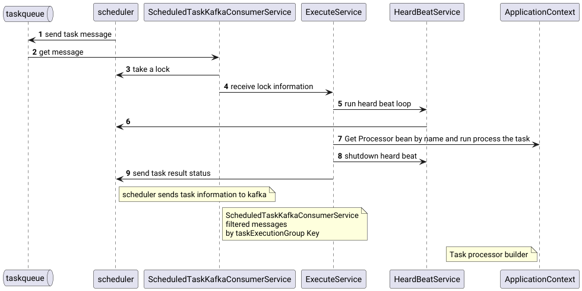
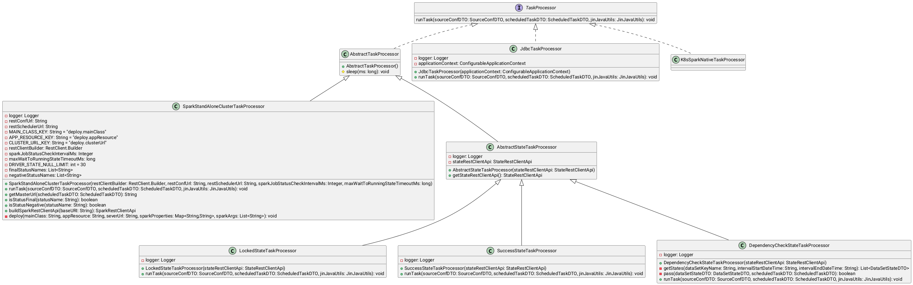
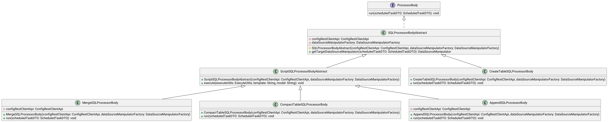

# Task executor service (yarina-task-executor-svc)

The task executor is the service that receives tasks scheduled by the scheduler, locks them, runs them through a task processor (TaskProcessor) and reports the result back to the scheduler.

## Overview

`yarina-task-executor-svc` is the yarina service responsible for actually executing the tasks scheduled by `yarina-scheduler-svc`. The service does not know when and which tasks should run — it only consumes tasks ready for execution from Kafka and executes them.

Execution flow:

1. `yarina-scheduler-svc` publishes messages about tasks ready for execution to the Kafka topic `scheduled_task_msg`.
2. Instances of `yarina-task-executor-svc` consume these messages through `ScheduledTaskKafkaConsumerService`.
3. Messages are filtered by execution group (`taskExecutionServiceGroupName`): an instance processes only those tasks whose group matches the `group.id` of its Kafka consumer.
4. For each task the service locks it in `yarina-scheduler-svc` via `lockTaskById`, receiving the full task description (`ScheduledTaskLockDTO`) — a merge of the task template and the overridden values of the specific task.
5. While running, a background heartbeat loop (`HeardBeatService`) periodically confirms to the scheduler that the task is alive.
6. The task is executed by the selected `TaskProcessor` (by the name specified in the task configuration).
7. On completion the heartbeat is stopped and the result (`TaskResultDTO`) is sent to the scheduler via `lockRelease`: `SUCCESS`, `FAILED` or `CONF_ERROR`.

The execution parallelism is limited by the `concurrency` parameter of the Kafka consumer and the service thread pool. Scaling is described in [scaling.md](scaling.md).

## Architecture



The service is the point of task execution parallelization: it receives a job, adapts it for the execution environment and hands it over to that environment, waiting for the result. This is a lightweight but blocking operation.

External interactions:

- **Kafka** — receiving tasks (`scheduled_task_msg`), deserialization of `ScheduledTaskMsgDTO`.
- **yarina-scheduler-svc** — locking a task (`lockTaskById`), heartbeat (`lockHeartBeat`), releasing the lock with the result (`lockRelease`).
- **yarina-config-svc** — retrieving the source/target configuration (`SourceConfDTO`) by the dataset key name.
- **yarina-state-svc** — working with the dataset state model (required by state-model processors).

Task processors:



- **Spark processors** — run the task body on a remote Spark standalone cluster via the REST API `/v1/submissions`.
- **State-model processors** — move the dataset interval to the `Locked`/`Success` status, check dependencies.
- **JDBC processor** — executes a `TaskProcessorBody` through a JDBC driver.

Task bodies (`TaskProcessorBody`):



Processors that use SQLTemplate templates are compatible with both Spark tasks and the JDBC processor. The processors are described in detail in [processors.md](processors.md).

## Domains

A **domain** is the unit of isolation of the configuration (`yarina-config-svc`): every
domain owns its own Git repository and every construct loaded from it is stamped with the
domain name as `domainKeyName`. That stamp is ownership, not identity: `keyName` remains the
global primary key, so the same `keyName` never exists twice - two domains pointing at the
same physical table use two distinct `keyName`s. See
[config-svc: Domains](../../yarina-config-svc/doc/content_configuration/domains.md).

This service never owns domains: it holds no domain tree, no domain registry and no domain
filter of its own. A domain reaches it only as metadata on the objects it already works
with.

### Where the domain comes from

```
yarina-scheduler-svc
  └─ ScheduledTaskMsgDTO.domainKeyName            (task message on scheduled_task_msg)
       └─ ScheduledTaskLockDTO
            └─ ExecuteService
                 ├─ configRestClientApi.getSourceConfDTO(dataSetKeyName)  ──▶ yarina-config-svc
                 │     DataSourceDTO / DataSetDTO / DriverDTO — each carries its own domainKeyName
                 └─ DataSourceDTO.service.properties  ──▶ JdbcConnectionFactory (secret resolution)
```

Two things carry the domain into the execution of a task:

- **`ScheduledTaskMsgDTO.domainKeyName`** — a field of the Kafka message the scheduler
  publishes to `scheduled_task_msg`. The message is deserialized into
  `ScheduledTaskLockDTO` together with the task description returned by
  `lockTaskById`.
- **The configuration DTOs themselves** — `DataSourceDTO`, `DataSetDTO` and `DriverDTO`
  returned by `getSourceConfDTO(...)` expose `domainKeyName`, so the executor always knows
  which domain every data source it opens belongs to. The data source actually used by a
  task is selected by the task's data set, and the data set of a domain is defined in the
  repository of that domain.

Grouping of executors is **not** domain-based. An instance takes only the tasks whose
`taskExecutionServiceGroupName` matches the Kafka `group.id` of its consumer; domain
separation between the executors of a group is enforced by the scheduler, which refuses to
publish a task whose schedule domain is not allowed by the task's
`TaskExecutionServiceGroup` (see
[scheduler-svc: Domains](../../yarina-scheduler-svc/doc/readme.md#domains)).

### Domain-scoped data source settings

For deployments that keep per-domain connection settings locally, the service binds a
two-level map under `yarina.task-executor` (`DomainDataSourceServiceProperties`):

```yaml
yarina:
  task-executor:
    domains:                          # <domainKeyName>:
      platform:                       #   <dataSourceKeyName>:
        yarinastorage:             #     service-properties:   (free-form map)
          service-properties:
            secretProvider: org.yarina.security.jdbc.BaoJdbcSecretProvider
            secret-key: "kv/data/yarina/database:password"
            vault-url: "http://openbao:8200"
            user: postgresUser
            fetchSize: "10000"
```

`getServiceProperties(domainKey, dataSourceKey)` resolves the map and returns
`Optional.empty()` for an unknown domain, an unknown data source or a data source without
`service-properties`. The keys inside `service-properties` are free-form and are not
validated by the binding; they carry the same secret-provider options as the
`service.properties` of a JDBC data source (see
[Secret resolution in the JDBC path](#secret-resolution-in-the-jdbc-path)).

The map **is applied on the execution path**. `ExecuteService.prepareProperties(...)` looks up
every data source of the resolved source configuration under
`scheduledTaskDTO.getDomainKeyName()` and merges the result into
`dataSourceDTO.getService().getProperties()` - the very map that reaches `JdbcConnectionFactory`
and the secret resolution. `putAll` semantics apply: values from the domain-local
configuration **override** the same keys coming from `yarina-config-svc`, which makes the
block a per-domain override of the repository-declared `service.properties` (useful for
keeping credentials out of Git). A domain that is `null` — for example a task message without a
domain — simply resolves to `Optional.empty()` and leaves the repository values untouched.

### Known limitations

The following is the current state of the code and is intentional to document explicitly:

- The lookup key is `scheduledTaskDTO.getDomainKeyName()`. `ScheduledTaskMsgDTO.domainKeyName`
  is not populated by the scheduler (the scheduler never calls its setter), so the domain of an
  incoming task message is `null`; whether the domain-local block is applied therefore depends on
  how `lockTaskById` populates `ScheduledTaskLockDTO.scheduledTaskEffectiveDTO`. Verify
  `domainKeyName` on the effective task description before relying on the override.
- The data source is looked up by the data set key alone: `getSourceConfDTO` takes no domain
  parameter. The domain scoping of the returned constructs is decided by the configuration
  service.
- `service-properties` is merged unvalidated: an unknown key or a typo is silently passed
  downstream, where it is ignored by the secret resolver.

## Modules

### yarina-task-executor-svc

The service itself. Contains:

- the entry point `TaskExecutorApplication`;
- the task Kafka consumer `ScheduledTaskKafkaConsumerService`;
- the executor `ExecuteService` — orchestration: locking, Jinja context rendering, running the processor, sending the result;
- `HeardBeatService` — background heartbeat loop for acquired locks;
- task processors (`processor`): Spark, state model, JDBC;
- configurations (`configuration`): Kafka, REST clients, factories, thread pool.

### yarina-task-executor-api

The library of execution contracts. Contains:

- `TaskProcessor` — the task processor interface (`runTask`);
- `ProcessorBody` and SQL body implementations (`AppendSQLProcessorBody`, `MergeSQLProcessorBody`, `CreateTableSQLProcessorBody`, `CompactTableSQLProcessorBody`);
- data source abstractions: `DataSourceManipulator`, `DataSourceManipulatorFactory`, JDBC connection and execution factories;
- `SQLTemplateResolver` / `SQLTemplateFactory`.

### yarina-task-executor-rest-client

REST client for managing the task executor. Contains:

- `TaskExecutorRestClientApi` (the contract lives in `yarina-common-rest-client`);
- `TaskExecutorRestClientApiImpl` — implementation based on `RestClientHelper`;
- `TaskExecutorRestClientConfiguration` — connection configuration via `yarina.client.rest.taskexecutor.server.url`.

## API Endpoints

The service REST controller (`TaskProcessorConfigController`) does not expose ready endpoints in the current version. Reserved path of the client contract (`TaskExecutorRestClientApi.getScheduledTaskLockDTO`):

| Method | Path | Description |
|---|---|---|
| GET | `/v1_0/taskexecutor/processor/config/lock/{id}` | Retrieving lock information by `lockId` (reserved) |

Health-check endpoints (from `yarina-common-health`):

| Method | Path | Description |
|---|---|---|
| GET | `/healthz` | Liveness check (`{"status":"UP"}`) |
| GET | `/readyz` | Readiness check (`{"status":"READY"}`) |

The health-check paths are configured via the `yarina.health.liveness-path` and `yarina.health.readiness-path` parameters.

## Configuration

Main parameters (`src/main/resources/application.yml`):

```yaml
server:
  port: 8089
yarina:
  client:
    rest:
      state:
        server:
          url: http://127.0.0.1:8082
      config:
        server:
          url: http://127.0.0.1:8080
      scheduler:
        server:
          url: http://127.0.0.1:8081
  task-executor:
    # Domain-scoped data source settings. Bound, but not applied to execution yet -
    # see the "Known limitations" subsection of the Domains chapter.
    domains:
      platform:
        yarinastorage:
          service-properties:
            user: postgresUser
    service:
      heart-beat-initial-delaY-ms: 5000
      heart-beat-interval-ms: 5000
      max-lock-retries: 5
      max-lock-retries-duration-ms: 5
      id: first1
    processor:
      sparkStandAloneClusterTaskProcessor:
        maxWaitToRunningStateTimeoutMs: 120000
        sparkJobStatusCheckIntervalMs: 3000
    scheduled:
      task:
        kafka:
          consumer:
            concurrency: 1
            properties:
              bootstrap.servers: 192.1.193.20:9092
              group.id: default
              auto.offset.reset: earliest
            topics: scheduled_task_msg
```

| Parameter | Description |
|---|---|
| `server.port` | Service port |
| `yarina.client.rest.state.server.url` | URL of `yarina-state-svc` |
| `yarina.client.rest.config.server.url` | URL of `yarina-config-svc` |
| `yarina.client.rest.scheduler.server.url` | URL of `yarina-scheduler-svc` |
| `yarina.task-executor.service.heart-beat-initial-delaY-ms` | Delay before the heartbeat sending starts |
| `yarina.task-executor.service.heart-beat-interval-ms` | Heartbeat sending interval. Must be lower than `yarina.scheduler.task.retry.delay-ms` in the scheduler |
| `yarina.task-executor.service.max-lock-retries` | Number of lock acquisition attempts when the scheduler is temporarily unavailable |
| `yarina.task-executor.service.max-lock-retries-duration-ms` | Delay between lock attempts |
| `yarina.task-executor.service.id` | Instance identifier within the executor group (pod/host name). Sent to the scheduler on task lock |
| `yarina.task-executor.scheduled.task.kafka.consumer.concurrency` | Number of task consumption threads |
| `...consumer.properties.bootstrap.servers` | Kafka broker address |
| `...consumer.properties.group.id` | Executor group. Must match the task's `taskExecutionServiceGroupName`, otherwise the task is ignored |
| `...consumer.properties.auto.offset.reset` | Offset reset strategy when no offset exists |
| `...consumer.topics` | Topic of task receipt (default `scheduled_task_msg`) |
| `yarina.task-executor.processor.sparkStandAloneClusterTaskProcessor.maxWaitToRunningStateTimeoutMs` | Max time to wait for the Spark job transition to `RUNNING` (default `120000` ms) |
| `yarina.task-executor.processor.sparkStandAloneClusterTaskProcessor.sparkJobStatusCheckIntervalMs` | Spark job status polling interval (default `3000` ms) |
| `yarina.task-executor.domains.<domain>.<dataSource>.service-properties` | Free-form per-domain data source settings. Bound but not applied to execution, see [Domains](#domains) |

### Secret resolution in the JDBC path

The service opens JDBC connections through the `JdbcConnectionFactory` of `yarina-task-executor-api`.
With the `yarina-credential-providers-jdbc` jar on the classpath, a JDBC datasource `service.properties`
(`ServiceDTO.properties`) may contain a `secretProvider` option - then the password is resolved at runtime
from OpenBao/Vault or Yandex Cloud Lockbox and never stored in configuration. The security options are stripped
before the connection is opened. Options and examples: [properties.md](properties.md), full details:
[security guide](../../doc/security/security.md).

Full description of the parameters with comments: [properties.md](properties.md).

Scaling concerns (vertical, horizontal, segment-based): [scaling.md](scaling.md).

## Security

`yarina-task-executor-svc` is protected with OAuth 2.0 / OIDC and uses Keycloak as the identity provider (realm `yarina`). Spring Security is configured as an **OAuth2 resource server**: every request must carry a valid JWT issued by the realm, otherwise the service returns `401`.

### Authentication

- **User requests** (UI BFF, CLI, direct API calls) - the JWT is validated via `spring.security.oauth2.resourceserver.jwt.issuer-uri`. Roles from the `realm_access.roles` claim are converted to `ROLE_<NAME>` authorities by `KeycloakRoleConverter` and can be used with `@PreAuthorize`.
- **Service-to-service calls** (`BearerTokenClientHttpRequestInterceptor`) - when a request originates from a background task (no user JWT in the `SecurityContext`), the outgoing `RestClient` obtains a `client_credentials` token through the `OAuth2AuthorizedClientManager` using the `keycloak-internal` registration (client `yarina-internal-client`) and attaches it as `Authorization: Bearer`. When a user JWT is present, it is propagated unchanged.
- Security can be switched off entirely with `yarina.security.enabled=false` (all requests become anonymous).

### Audit logging

`AuditLoggingFilter` writes one line per request to the `AUDIT_LOG` logger (file `logs/audit.log`):

```
User ID: <subject>, Username: <preferred_username>, Method: <method>, URI: <uri>, HTTP status: <status>
```

Tokens obtained with the service account are logged with the configured `yarina.security.audit.service-account-name` (default `system`) instead of the username.

### Required settings

| Property / env | Default | Description |
|---|---|---|
| `KEYCLOAK_ISSUER_URI` | `http://yarina-auth-svc:8080/realms/yarina` | Keycloak realm URL |
| `KEYCLOAK_INTERNAL_CLIENT_SECRET` | `super-secret-internal-key-987654321` | Secret of `yarina-internal-client` |
| `VAULT_TOKEN` | — | OpenBao/Vault token used when JDBC sources are configured with `BaoJdbcSecretProvider` (secret resolution, see above) |
| `YC_AUTH_KEY_PATH` | — | Path to the authorized key file for the Yandex Cloud Lockbox IAM token (alternative to Instance Metadata) |
| `yarina.security.enabled` | `true` | Set `false` to disable security completely |
| `yarina.security.audit.service-account-name` | `system` | Username logged for service account tokens |
| `yarina.security.oauth2.internal-client-id` | `yarina-internal-client` | Client identifying service account tokens (`azp` claim) |
| `yarina.security.oauth2.client-registration-id` | `keycloak-internal` | OAuth2 client registration used by the interceptor |

`spring.security.oauth2.resourceserver.jwt.issuer-uri` and the `spring.security.oauth2.client` block (registration `keycloak-internal`) are preconfigured in `src/main/resources/application.yml`.

Whitelisted paths (no token required): `/healthz`, `/readyz`, `/actuator/**`, `/v3/api-docs/**`, `/swagger-ui/**`.

### Keycloak realm

The `yarina` realm must contain:

- **`yarina-internal-client`** - confidential client with *Service Accounts Enabled* (service-to-service calls);
- Realm roles `USER` / `ADMIN` (optional, used with `@PreAuthorize`).

The reference realm import is in `demo/compose/conf_infra/security/realms/yarina-realm.json`.